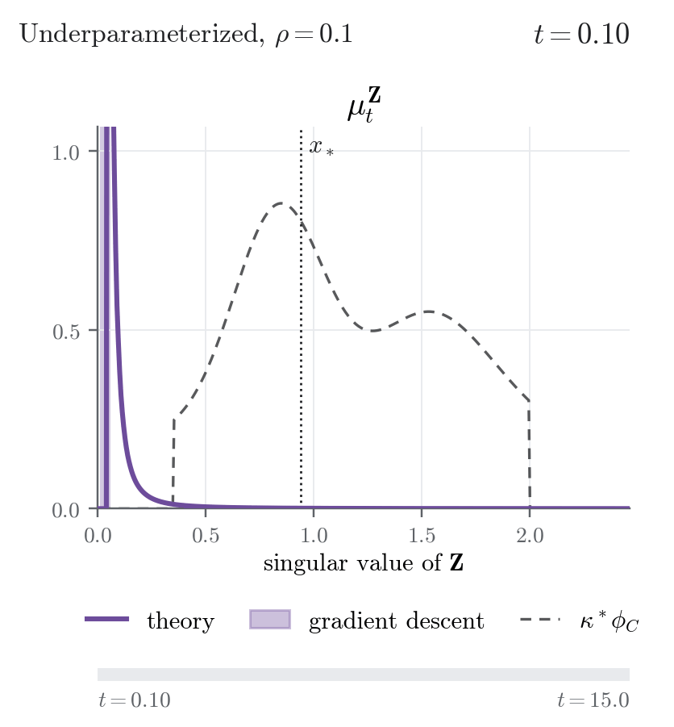
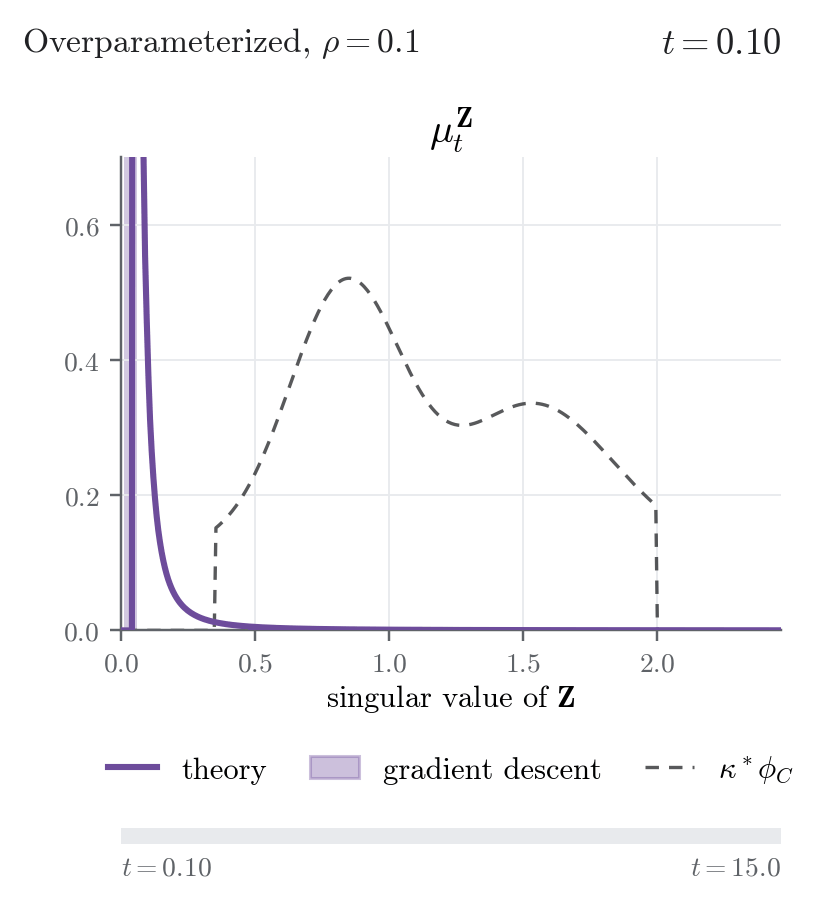
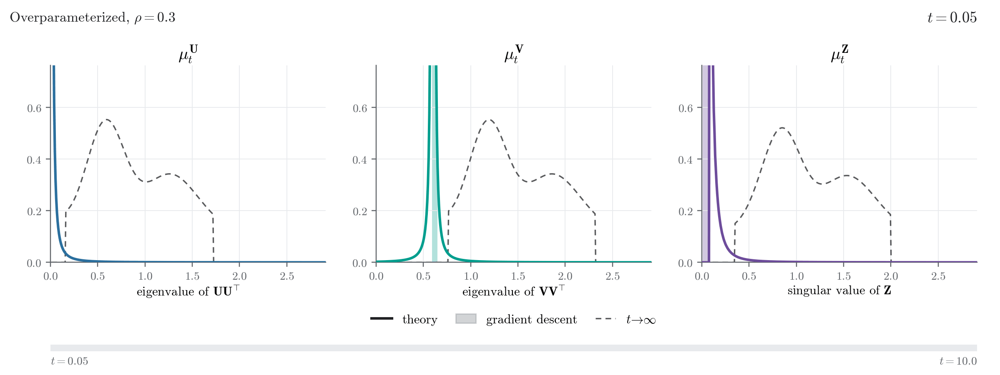
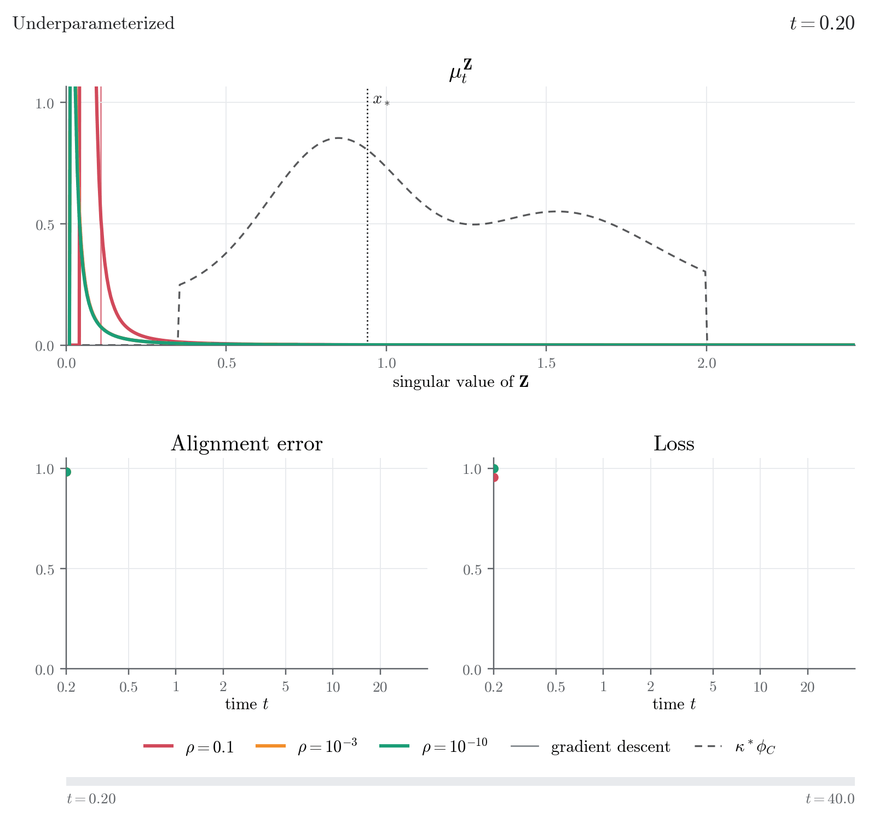
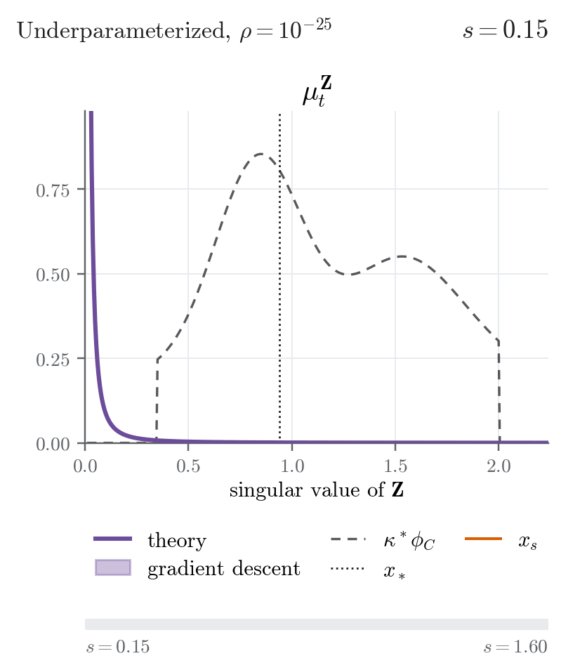
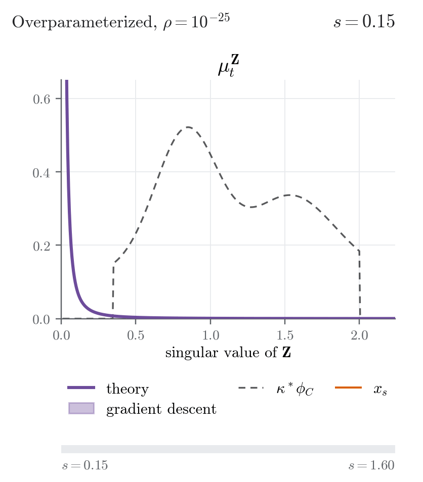

# Silent Alignment in Two-Layer Linear Networks: A High-Dimensional Perspective

Code for the paper

> **Silent Alignment in Two-Layer Linear Networks: A High-Dimensional Perspective**
> Simon Martin, Francis Bach, Giulio Biroli
> [arXiv:2610.29864](https://arxiv.org/abs/2610.29864)

We study gradient flow in a two-layer linear network $Z = UV^\top$, in the high-dimensional regime where the input, inner and output dimensions grow proportionally. Starting from a small initialization of scale $\rho$, training goes through two phases:

- **Silent alignment.** On a time scale of order one, the singular subspaces of the network align with those of the data, while the loss stays at its initial value.
- **Learning.** On the time scale $\log(1/\rho)$, the singular values escape zero one after the other, from the largest to the smallest. In high dimension this becomes a continuous front moving across the spectrum.

This repository contains the simulations, the code for the high-dimensional formulas, the figures of the paper, the numerical checks of its appendix, and animations of the spectra along training.

## Animations

The animations follow the spectrum of the network during training. Click on "Play the animation" to open each one. In sections 1 and 4, the two regimes of a network (underparameterized and overparameterized) are shown side by side.

**How to read them.** The horizontal axis shows singular values (for $Z = UV^\top$) or eigenvalues (for $UU^\top$ and $VV^\top$). The solid curves are the high-dimensional prediction of the paper, and the histograms are gradient descent ($d = 400$, 10 repetitions, stepsize $10^{-3}$). The dashed black curve is the spectrum of the data $\kappa^\ast \phi_C$ when only $Z$ is shown, and the long-time limit of each matrix when several are shown. The bar at the bottom shows the time. At initialization most of the spectrum sits at zero, and the part at zero is not drawn, so the histograms fill up as values leave zero.

### 1. Spectral transport

With a moderate initialization ($\rho = 0.1$), the whole spectrum of $Z$ grows out of zero and moves towards the spectrum of the data. Large singular values grow faster, at a rate proportional to their value, so the right part of the spectrum is learned first.

The final state depends on the width of the network. When the network has fewer hidden units than the rank of the data (underparameterized), it can only learn the largest singular values, those above a threshold $x_\ast$ (dotted line). When it has more (overparameterized), it learns the whole spectrum.

<details>
<summary><b>Play the animations</b> (left: underparameterized, κ = 0.55, κ* = 0.9; right: overparameterized, κ = 0.75, κ* = 0.55)</summary>
<br>

<table>
  <tr>
    <td align="center" width="50%"><picture><source media="(prefers-color-scheme: dark)" srcset="animations/gifs/transport_underparameterized_dark.gif"></picture></td>
    <td align="center" width="50%"><picture><source media="(prefers-color-scheme: dark)" srcset="animations/gifs/transport_overparameterized_dark.gif"></picture></td>
  </tr>
</table>
</details>

### 2. The three matrices

The network has two weight matrices, $U$ and $V$. Their spectra are tied together at all times: the eigenvalues of $VV^\top$ are those of $UU^\top$ shifted by $2\rho$, and the singular values of $Z$ follow from those of $UU^\top$. This animation shows the three spectra side by side ($\rho = 0.3$, overparameterized), each with its long-time limit in dashed black. In this regime $VV^\top$ also keeps extra eigenvalues frozen at $2\rho$, in directions the data does not see (not drawn).

<details>
<summary><b>Play the animation</b></summary>
<br>
<p align="center"><picture><source media="(prefers-color-scheme: dark)" srcset="animations/gifs/gram_matrices_dark.gif"></picture></p>
</details>

### 3. Late learning at small initialization

The same network is trained from three initialization scales, $\rho = 0.1$, $10^{-3}$ and $10^{-10}$. The top panel shows the spectrum of $Z$. The bottom panels show two quantities of gradient descent, both divided by their initial value: the alignment error, the distance between the singular directions of $Z$ and their final position (as in Figure 2 of the paper), and the loss.

The smaller the initialization, the later the spectrum leaves zero and the loss decreases: a singular value $\sigma$ of the data is learned after a time of order $\log(1/\rho)/(2\sigma)$. The alignment error, on the other hand, decreases on a time of order one for all three initializations. During the waiting period the loss does not move, but the singular directions of the network already align with those of the data. This is the silent alignment phenomenon.

<details>
<summary><b>Play the animation</b></summary>
<br>
<p align="center"><picture><source media="(prefers-color-scheme: dark)" srcset="animations/gifs/delayed_learning_dark.gif"></picture></p>
</details>

### 4. The spectral front

For a very small initialization ($\rho = 10^{-25}$), learning happens on the time scale $\log(1/\rho)$, so time is shown as $s = t/\log(1/\rho)$. At time $s$, the singular values above $x_s = 1/(2s)$ (orange line) are fully learned, and those below are still at zero. In finite dimension the singular values are learned one by one, from the largest to the smallest, with the network jumping from one saddle point of the loss to the next. In high dimension these jumps merge into a continuous front that sweeps the spectrum from right to left.

In the underparameterized case the front stops at the threshold $x_\ast$, reached at $s = 1/(2x_\ast)$: the network has no hidden units left for the smaller singular values. In the overparameterized case it crosses the whole spectrum.

<details>
<summary><b>Play the animations</b> (left: underparameterized, right: overparameterized)</summary>
<br>

<table>
  <tr>
    <td align="center" width="50%"><picture><source media="(prefers-color-scheme: dark)" srcset="animations/gifs/spectral_front_underparameterized_dark.gif"></picture></td>
    <td align="center" width="50%"><picture><source media="(prefers-color-scheme: dark)" srcset="animations/gifs/spectral_front_overparameterized_dark.gif"></picture></td>
  </tr>
</table>
</details>

## Installation

Python 3.10 or later. The dependencies are listed in `requirements.txt` and can be installed with

```bash
pip install -r requirements.txt
```

The simulator (`src/simulator.py`, used by the figure and validation scripts) needs PyTorch. The theory code (`src/theory.py`), `figures.ipynb` and `validation.ipynb` only need NumPy, SciPy and Matplotlib. `make_gifs.ipynb` needs PyTorch only with `SIMULATE = True`. Figure text is rendered with LaTeX (`text.usetex`), so a LaTeX installation is needed to draw the figures.

The large simulations ($d = 500$) are meant for a GPU. The simulator uses the GPU when PyTorch sees one, and the CPU otherwise. To check:

```bash
python -c "import torch; print(torch.cuda.is_available())"
```

## Contents

```
src/                shared code, imported by the scripts and notebooks
  simulator.py      finite-dimensional simulator: explicit Euler steps of the gradient flow, and all observables
  theory.py         high-dimensional formulas: self-consistent equations, spectral densities, projector distances,
                    small-initialization and logarithmic-time limits
  exact_flow.py     reference solutions of the gradient flow (Runge-Kutta and closed form), for the checks
  laws.py           densities of the singular values of C, and deterministic spectra
  configs.py        configurations shared by the figure scripts and the validation runs (Figures 6, 7, 8)
  runs.py           command-line options, saving of the archives, helpers for the step-size checks
  animations.py     animations of the spectra along training
  paths.py          folders of the repository
figures/            figure02.py ... figure08.py, figures.ipynb, pdf/ (the figures of the paper)
validation/         validation01_exact_flow.py ... validation06_dimension.py, validation.ipynb, plots/
animations/         make_gifs.ipynb, gifs/
data/               simulation archives (.npz), not stored in the repository (see below)
```

All paths are found from the location of the code, so the scripts and notebooks work from any working directory.

## Reproducing the figures

```bash
python figures/figure02.py   # ... up to figures/figure08.py
```

Each script saves its results as compressed `.npz` archives in `data/`. Then run `figures/figures.ipynb`, which reads the archives and writes the figures to `figures/pdf/`.

The archives used for the paper and the animations (about 210 MB) are available on Zenodo at [doi.org/10.5281/zenodo.23435597](https://doi.org/10.5281/zenodo.23435597). Create a folder `data/` at the root of the repository and put them in it, to draw the figures and the GIFs without rerunning the simulations.


All scripts accept the options `--device` (for instance `cpu` or `cuda`), `--dtype`, `--seed`, `--reps`, `--t-max`, `--out-dir`, and `--quick` for a small smoke test (`python figures/figure08.py --quick --out-dir data_quick`). `figures/figure06.py` also accepts `--regime continuous` or `--regime gapped`, to run a single regime.

## Numerical checks

The six validation scripts save `validationXX_*.npz` archives in `data/`, and `validation/validation.ipynb` reads them, prints the numbers to check and saves plots to `validation/plots/`.

1. **Exact flow** (`validation/validation01_exact_flow.py`, CPU). The Euler simulator against a fourth-order Runge–Kutta solution and the closed form of the flow, at $d = 40$.
2. **Step size, Figure 6** (`validation/validation02_stepsize_fig6.py`, GPU). Figure 6 with stepsizes $\eta/2$ and $\eta/4$.
3. **Step size, Figure 7** (`validation/validation03_stepsize_fig7.py`, CPU). Activation times of the singular modes with $\eta$, $\eta/2$ and $\eta/4$.
4. **Step size, Figure 8** (`validation/validation04_stepsize_fig8.py`, GPU). Loss and spectral mass with $\eta/2$ and $\eta/4$.
5. **Rotated teacher** (`validation/validation05_rotation.py`, GPU). Diagonal against randomly rotated data matrix.
6. **Finite size** (`validation/validation06_dimension.py`, GPU). Convergence in $d$ (100 to 800) to the high-dimensional formulas, for three aspect ratios.

The step-size checks reuse the configuration and the random seeds of the figure they check (`src/configs.py`), so run the corresponding figure script first. Sections 7 and 8 of the notebook need no new run: they check the quadrature of the theory code and exact identities on the figure archives.

## Making the animations

`animations/make_gifs.ipynb` writes the GIFs above to `animations/gifs/`, using `src/animations.py`. The high-dimensional densities are always computed. With `SIMULATE = True`, gradient descent is also run at the same times (PyTorch, GPU recommended) and drawn as histograms, and in section 3 also as the alignment-error and loss curves. Results are saved in `data/` as `animation_*.npz` archives, so changing the appearance does not recompute anything. The parameters of each animation are listed in the docstring of `GifSettings` in `src/animations.py`.

## Citation

```bibtex
@article{martin2026silent,
  title   = {Silent Alignment in Two-Layer Linear Networks: A High-Dimensional Perspective},
  author  = {Martin, Simon and Bach, Francis and Biroli, Giulio},
  journal = {arXiv preprint arXiv:2610.29864},
  year    = {2026}
}
```

## License

This code is released under the MIT License, see [LICENSE](LICENSE).